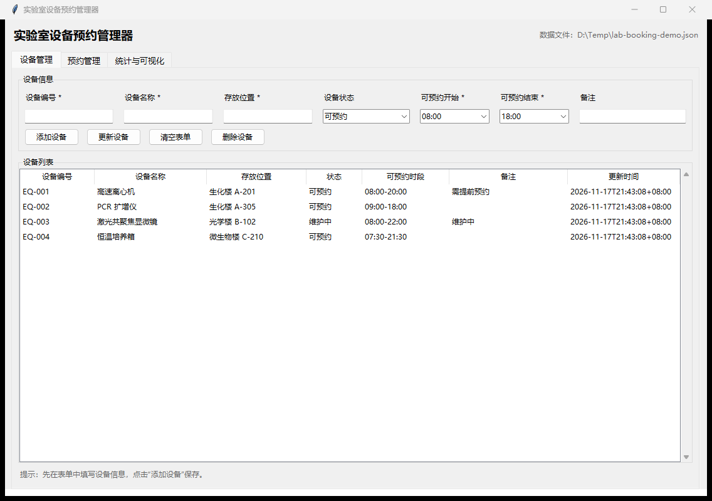
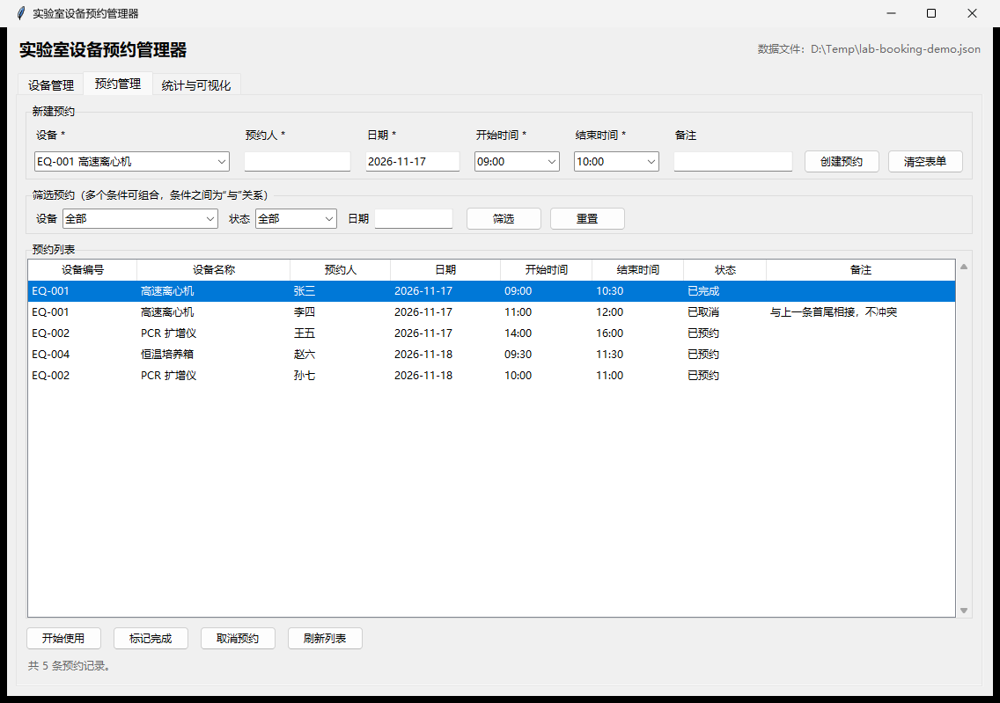
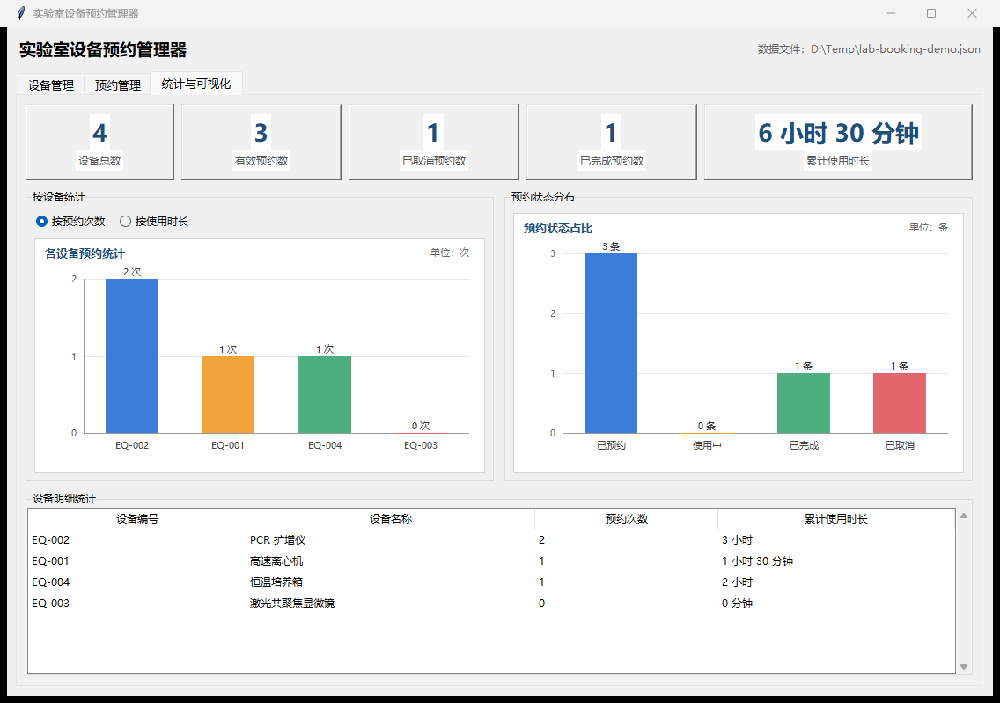

# 实验室设备预约管理器（成员二实现）

软工导论小组作业 · 成员二 · GitHub：Zsource-Fuyi · AI 工具：MiniMax M3.1 Flash

一个**完全离线**运行的本地桌面应用，用于管理实验室设备、创建预约、
检测时间冲突、查询预约记录并统计设备使用情况。

---

## 1. 技术栈

| 项目 | 说明 |
| --- | --- |
| 语言 | Python 3（开发与验证环境：Python 3.14.3 / Windows 11 x64） |
| 界面 | `tkinter` + `ttk`（Python 标准库自带，**不需要 pip install**） |
| 持久化 | 本地 JSON 文件（标准库 `json`） |
| 图表 | `tkinter.Canvas` 手绘柱状图（标准库，无第三方依赖） |
| 第三方依赖 | **无**，`requirements.txt` 为空 |

选择纯标准库的理由：需求要求"可在干净环境按说明启动""所有核心功能可离线使用"，
零依赖可以保证换一台机器、换一个 Python 版本也能直接 `python run.py` 启动，
不会因为 pip 源不可达而卡住。

## 2. 运行说明

### 2.1 环境要求

- Python 3.8 或更高版本（Windows / macOS / Linux 均可）
- 系统中带有 tkinter。Windows 版 Python 自带；
  Debian/Ubuntu 若缺失执行 `sudo apt install python3-tk`

### 2.2 启动命令

```bash
cd implementations/member-2
python run.py
```

可选参数：

| 参数 | 说明 |
| --- | --- |
| `--data <路径>` | 指定数据文件，默认 `implementations/member-2/data/data.json` |
| `--demo` | 数据文件为空时写入一组演示数据，便于快速查看界面效果 |

```bash
python run.py --demo                       # 带演示数据启动
python run.py --data D:/tmp/my-data.json   # 指定数据文件启动
```

### 2.3 数据文件位置

```text
implementations/member-2/data/data.json
```

- 首次保存数据时自动创建 `data/` 目录
- 该目录已被 `.gitignore` 忽略，**不会提交到 Git**
- 界面右上角会实时显示当前使用的数据文件路径
- 数据写入采用"临时文件 + 原子替换"，程序异常中断不会写出半截文件

数据文件结构：

```json
{
  "version": 1,
  "equipment": [ { "id": "...", "code": "EQ-001", "...": "..." } ],
  "reservations": [ { "id": "...", "equipment_id": "...", "...": "..." } ]
}
```

字段语义与 `docs/data-schema.md` 完全一致，未额外添加业务字段。

### 2.4 运行测试

```bash
cd implementations/member-2
python -m unittest discover -s tests -t .
```

预期输出：`Ran 118 tests ... OK`

测试分四层：

| 文件 | 覆盖内容 |
| --- | --- |
| `tests/test_validation.py` | 时间 / 日期 / 必填 / 时间区间校验 |
| `tests/test_conflict.py` | 半开区间重叠判定、跨设备跨日期、已取消不占用 |
| `tests/test_store.py` | JSON 读写往返、原子写、损坏文件处理 |
| `tests/test_service.py` | 业务规则、状态机、删除保护、筛选、统计 |
| `tests/test_acceptance.py` | AC1~AC12 业务层验收用例 |
| `tests/test_ui_flow.py` | AC1~AC12 界面层验收用例（驱动真实按钮回调） |

## 3. 功能对照

| 需求 | 实现位置 |
| --- | --- |
| FR1 设备管理（增删改查、编号唯一） | `app/ui/equipment_tab.py` + `LabService.add/update/delete_equipment` |
| FR2 预约管理（创建、列表、取消） | `app/ui/reservation_tab.py` + `LabService.add_reservation` |
| FR3 冲突检测（重叠禁止、相接允许、已取消不占用） | `app/conflict.py` + `app/service.py` |
| FR4 查询与筛选（设备 / 日期 / 状态，可组合） | `ReservationFilter` + 预约页签筛选栏 |
| FR5 状态管理（booked→in_use→completed / cancelled） | `app/models.py: ALLOWED_TRANSITIONS` |
| FR6 统计与可视化（总数、有效数、取消数、柱状图） | `app/ui/stats_tab.py` + `app/ui/widgets.py: BarChart` |
| FR7 本地持久化 | `app/store.py`（JSON） |
| FR8 输入校验 | `app/validation.py` + `LabService` 业务校验 |

## 4. 界面说明

三个页签：

1. **设备管理** —— 上方表单录入设备（编号 / 名称 / 位置 / 状态 / 可预约时段 / 备注），
   下方列表展示全部设备。选中列表行可回填表单进行编辑；
   删除设备时若有历史预约会询问"保留历史预约 / 同时删除历史预约 / 取消"。
2. **预约管理** —— 上方创建预约，中间按设备 / 状态 / 日期组合筛选，
   下方列出预约记录，并提供"开始使用 / 标记完成 / 取消预约"三个状态流转按钮。
3. **统计与可视化** —— 顶部五张指标卡（设备总数、有效预约数、已取消数、已完成数、
   累计使用时长），中部两张柱状图（按设备预约次数 / 使用时长、预约状态分布），
   底部设备明细表。





## 5. 关键业务规则

- **时间区间按半开区间 `[开始, 结束)` 处理**，因此 `09:00-10:00` 与 `10:00-11:00` 首尾相接不算冲突。
- **预约时间粒度 30 分钟**，开始与结束时间必须落在 `:00` / `:30` 刻度上，界面上用下拉框选择。
- **只有 `booked` / `in_use` 的预约占用设备时间**并参与冲突判断；
  `completed` / `cancelled` 不占用时间。
- **预约必须落在设备的可预约时段内**，且设备状态必须为 `available`。
- **设备编号全局唯一**（不区分大小写）。
- **状态流转严格按数据契约**：`booked → in_use`、`booked → cancelled`、`in_use → completed`；
  其余流转（如 `completed → cancelled`、`cancelled → booked`）一律拒绝并提示原因。
- **设备存在有效预约时禁止删除**；删除后可选择保留历史预约，
  历史预约不占用设备时间，不影响后续预约的冲突判断。

## 6. 目录结构

```text
implementations/member-2/
├── run.py                  启动入口
├── README.md               本文件（运行说明）
├── requirements.txt        依赖清单（空，零第三方依赖）
├── ai-notes.md             AI 使用记录
├── app/
│   ├── models.py           领域模型、状态枚举、状态流转表
│   ├── validation.py       输入校验
│   ├── conflict.py         冲突检测
│   ├── store.py            JSON 持久化
│   ├── service.py          业务服务层
│   ├── errors.py           异常定义
│   ├── paths.py            路径常量
│   └── ui/                 tkinter 界面
│       ├── main_window.py
│       ├── equipment_tab.py
│       ├── reservation_tab.py
│       ├── stats_tab.py
│       └── widgets.py
├── tests/                  单元测试与验收测试
├── tools/                  开发辅助脚本（截图、窗口抓取）
└── docs/screenshots/       界面截图
```

## 7. 已知边界与设计取舍

- 按需求范围排除项，未实现登录、云端同步、审批流、消息推送、扫码签到等功能。
- 单日预约，不支持跨天（按需求第 5 节 MVP 时间规则）。
- 设备编号唯一性判定不区分大小写（`eq-001` 与 `EQ-001` 视为重复），
  这是本实现对"编号不能重复"的收紧解释，已在个人报告中说明。
- 预约时间强制 30 分钟粒度，是对需求"预约时间粒度为 30 分钟"的直接落实。
